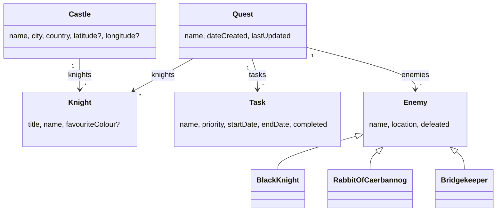

# The Quest for the Holy Grails

<div class="pt-12">
  <span class="text-xl opacity-75">
    A Grails 8 Tutorial
  </span>
</div>

<div class="pt-8 text-sm opacity-60">
  Community Over Code · Glasgow · 12 October 2026
</div>

<div class="abs-br m-4 text-xs opacity-50">
  Doune Castle, a.k.a. Camelot · photo: Bill Boaden, CC BY-SA 2.0, via geograph.org.uk / Wikimedia Commons
</div>

<!--
40 minutes. Three beats: build the domain, one service one test, what changed in 8 (and 7).
The programme says "Grails 7 Tutorial". Grails 8.0.0 shipped yesterday morning; the app and the labs moved to it the same day. Open with that.
Everything shown is in the repo, tagged per stage. Live-code only what is marked LIVE in the notes.
-->

---

# Contact Info

Ken Kousen<br>
Kousen IT, Inc.

- ken.kousen@kousenit.com
- http://www.kousenit.com
- http://kousenit.org (blog)
- Social Media:
  - [@kenkousen](https://twitter.com/kenkousen) (Twitter)
  - [@kousenit.com](https://bsky.app/profile/kousenit.com) (Bluesky)
  - [kenkousen.substack.com](https://kenkousen.substack.com) (Tales from the jar side)

---

# The Book

<div class="grid grid-cols-2 gap-8 mt-4 items-center">
  <div class="flex justify-center">
    
  </div>
  <div>

### Claude Code: Up and Running
*Harness the Power of Agentic Coding*

Ken Kousen · O'Reilly Media

On the O'Reilly learning platform:
https://learning.oreilly.com/library/view/claude-code-up/0642572388782/

  </div>
</div>

---

# The Quest

A complete Grails 8 application, built in stages, with a lab guide

<div class="grid grid-cols-2 gap-8 pt-4">
<div>

**Three beats, forty minutes**

1. Build the domain
2. One service, one test
3. What changed in 8, and in 7

</div>
<div>

**Take it home**

- `github.com/kousen/holygrails8`
- `labs.md`: twelve labs, one tag each
- `git checkout step5-model` to join at any point
- `main` is the finished app

</div>
</div>

<div class="pt-8 text-sm opacity-70">
Ran this course in 2012 on Grails 2, in 2018 on Grails 3.3, and in 2021 on Grails 5.0.
Same knights. New framework. Same jokes.
</div>

---

# Why Monty Python?

Because a domain model should be memorable, and this one does structural work

| Domain class | Feature it carries |
|---|---|
| `Quest` has many `Task`s | one-to-many, cascading delete, timestamps |
| `Task` priority 1..5, end after start | range and custom validators |
| `Knight` favourite colour | a validator with an exception for Galahad |
| `Castle` with coordinates | a service, an external API, a map |
| `Enemy` → `BlackKnight`, `RabbitOfCaerbannog`, `Bridgekeeper` | inheritance mapping |

The castles are the filming locations. Doune Castle was Camelot. It is an hour from here.

---
layout: section
---

# Grails 8 at a glance

---

# Grails 8.0.0 shipped yesterday

7.0.0 was the first Apache release, 28 October 2025; 8.0.0 is the second major in a year

| | Grails 7.2.4 | Grails 8.0.0 |
|---|---|---|
| Java | 17+ | **21+**, 25 works |
| Groovy | 4.0.33 | **5.1.3** |
| Spring Boot / Framework | 3.5.16 / 6.2.19 | **4.1.1 / 7.0.9** |
| Jackson · Tomcat · Servlet | 2 · 10.1 · 6.0 | **3 · 11 · 6.1** |
| Hibernate | 5.6.15 | 5.6.15, or **7** from Forge |
| Spock · Gradle | 2.3 · 8.14.5 | **2.4 · 9.8.0** |

<!--
Group id for everything, since 7: org.apache.grails, versioned by one BOM.
Hibernate did NOT move by default: 5.6.15 is still what Forge generates. Hibernate 7 is a Forge option with its own BOM.
This app was built on 7.2.4 and ported to 8.0.0 yesterday. Everything in the labs is 8 now; beat three says what the port touched.
-->

---

# Grails Forge

The generator moved to `grails.apache.org/start`, and it has an API

```bash
curl -L -o app.zip \
  "https://latest.grails.org/create/web/com.kousenit.holygrails?jdkVersion=JDK_25&gorm=HIBERNATE&test=SPOCK&features=testcontainers"
```

What you get:

```
build.gradle            Grails BOM + Gradle plugins, no versions on dependencies
grails-app/             conf, controllers, domain, services, views, init, i18n
src/test/groovy         unit tests
src/integration-test    integration and functional tests
grailsw, gradlew        wrappers; nothing to install
```

Commit it before you touch it. Every later diff is yours.

---

# `grails run-app`

```
       holygrails8: 0.1 | JVM: Eclipse Adoptium 25.0.4 | Grails: 8.0.0
    Groovy: 5.1.3 | Spring Boot: 4.1.1 | Spring: 7.0.9 | Tomcat: 11.0.24.0
Grails application running at http://localhost:8080 in environment: development
```

- The banner is 7; the versions in it are 7.1; the colour and the container are 8
- `run-app` and `./gradlew bootRun` are the same embedded Tomcat
- The `grails` command delegates to Gradle now. Watch for `CONFIGURE SUCCESSFUL`

<!--
Show the starter running: tag step0-starter. 2 minutes.
-->

---
layout: section
---

# Beat one: build the domain

---

# A domain class

```bash
grails create-domain-class Quest
```

```groovy
package com.kousenit

class Quest {
    String name

    String toString() { name }

    static constraints = {
        name blank: false
    }
}
```

- `grails-app/domain`: GORM adds `id`, `version`, persistence, validation
- Every property is non-nullable unless you say otherwise
- Constraints are a DSL; the scaffolding reads them to build forms

<!--
LIVE: type this class. Then generate-all. ~4 minutes to the running list page.
IDE gag: in the toolbar above Quest, QuestController resolves but QuestService says "Nothing here". The plugin does not recognise a data service declared as an interface; Castle's @Scaffold service (a class) resolves fine. Issue 4 on the closing list; the Grails devs in the room can carry it to JetBrains.
-->

---

# `generate-all`

```bash
grails generate-all com.kousenit.Quest
```

| File | Lines | What |
|---|---|---|
| `QuestController.groovy` | 99 | index, show, create, save, edit, update, delete |
| `QuestService.groovy` | 17 | a GORM **data service**: an interface GORM implements |
| `views/quest/*.gsp` | 4 files | Fields plugin, Bootstrap 5.3 |
| `QuestControllerSpec.groovy` | | unit test skeleton |
| `QuestServiceSpec.groovy` | | integration test skeleton |

---

# A data service is an interface

```groovy
@Service(Quest)
interface QuestService {
    Quest get(Serializable id)
    List<Quest> list(Map args)
    Long count()
    void delete(Serializable id)
    Quest save(Quest quest)
}
```

- GORM reads the method names and generates the implementation at compile time
- Every method is transactional
- The controller gets it by property name: `QuestService questService`
- Add your own: `List<Quest> findAllByNameLike(String pattern)` is enough; GORM writes the body

---

# The skeletons fail on purpose

```groovy
def populateValidParams(params) {
    assert params != null
    // TODO: Populate valid properties like...
    //params["name"] = 'someValidName'
    assert false, "TODO: Provide a populateValidParams() implementation for this generated test suite"
}
```

Three red tests after every `generate-all`, so you cannot forget them.

<!--
Small one for the team: IntelliJ flags populateValidParams as "can be static", and it is right. The helper takes params as an argument rather than reading the spec's params property, so it never touches instance state. Either make the template's helper static or have it use the property. Cosmetic, but it is the first thing the IDE says about every generated controller spec.
-->

<div class="pt-4">

Also: a blank name reports **cannot be null**, not blank. Data binding trims and converts `""` to `null` before validation.

```yaml
grails:
  databinding:
    convertEmptyStringsToNull: false
```

```properties
quest.name.blank=Quests must have a name
```

Message key pattern: `className.propertyName.constraint`

</div>

---

# A related class

```groovy
class Task {
    String name
    int priority = 3
    LocalDate startDate = LocalDate.now()
    LocalDate endDate = LocalDate.now()
    boolean completed

    String toString() { name }

    static belongsTo = [quest: Quest]

    int getDuration() { (endDate - startDate) + 1 }

    static constraints = {
        name blank: false
        priority range: 1..5
        endDate validator: { LocalDate value, Task task ->
            value >= task.startDate
        }
    }
}
```

<!--
LIVE: the validator. belongsTo = owning side, cascade delete. getDuration is derived: no transients needed in 7.
endDate - startDate: see next slide.
-->

---

# Groovy 5 is modular (so was 4)

`endDate - startDate` does not compile in a fresh Grails 8 app

<div class="grid grid-cols-2 gap-8">
<div>

Grails ships:

- `groovy`
- `groovy-json`
- `groovy-sql`
- `groovy-templates`
- `groovy-xml`

</div>
<div>

Grails does not ship:

- `groovy-datetime`
- (`groovy-console` rides along with `grails console`, which 8 serves from a `-cli` jar)

</div>
</div>

```groovy
implementation "org.apache.groovy:groovy-datetime"   // version from the Groovy BOM
```

You get `date - date`, `date + 1`, `date.format('MMM d')`, and date ranges back.

---

# Test by error code

```groovy
class TaskSpec extends Specification implements DomainUnitTest<Task> {

    @Shared Quest quest = new Quest(name: 'Seek the grail')
    Task task = new Task(name: 'Defeat the Black Knight', quest: quest)

    void "priorities above 5 are not valid"() {
        when:
        task.priority = 6

        then:
        !task.validate()
        task.errors['priority'].code == 'range.toobig'
    }
}
```

- `DomainUnitTest`: GORM without a database
- `@Shared` for the fixture nobody mutates; a plain field is rebuilt for every feature
- The error codes (`blank`, `nullable`, `range.toobig`, `validator.invalid`) are your message keys

---

# One test, five cases

```groovy
    @Unroll
    void "a task with priority #priority is valid"() {
        when:
        task.priority = priority

        then:
        task.validate()

        where:
        priority << (1..5)
    }
```

The report lists *a task with priority 1 is valid* through *a task with priority 5 is valid*. Change the range to `1..4` and watch which one fails.

---

# Seed data

```groovy
static Quest seekTheGrail() {
    LocalDate today = LocalDate.now()
    new Quest(name: 'Seek the grail')
        .addToTasks(name: 'Run away from killer rabbit', priority: 1)
        .addToTasks(name: 'Answer the Bridgekeeper', priority: 4, startDate: today + 1, endDate: today + 1)
        .addToTasks(name: 'Defeat the Black Knight', completed: true, startDate: today - 3, endDate: today - 2)
        .addToTasks(name: 'Bring out your dead', completed: true, priority: 5)
        .addToTasks(name: 'Find a shrubbery for the Knights Who Say Ni', priority: 2, endDate: today + 7)
        .addToTasks(name: 'Weigh a witch against a duck', priority: 3)
        .addToTasks(name: 'Lobbest thou thy Holy Hand Grenade of Antioch', priority: 5, startDate: today + 2)
        .save(failOnError: true)
}
```

```groovy
class BootStrap {
    def init = { servletContext ->
        if (Environment.current != Environment.TEST && Quest.count() == 0) {
            Quest quest = SeedData.seekTheGrail()
            SeedData.theCourt(quest)
        }
    }
}
```

`failOnError: true`: `save()` returns `null` on bad data by default. In startup code, throw.

---

# Three ways to ask

```groovy
// dynamic finders: methods derived from the name
Task.findAllByPriorityLessThanAndStartDateBetween(4, today - 1, today + 1)
Task.countByCompletedAndPriorityGreaterThan(false, 3)

// criteria: a builder, composable at runtime, joins by nesting
Quest.withCriteria {
    tasks {
        eq 'completed', false
        eq 'priority', 5
    }
}

// where queries: compile-time checked, lazy, composable
def open = Task.where { completed == false }
def overdue = open.where { endDate < today }
overdue.count()
```

<!--
LIVE: run QuestQueriesSpec, show two finders. The console still exists in 8, but a test is a better tutorial medium.
-->

---

# `@Rollback` and `setup()` do not mix

```groovy
@Integration
@Rollback
class QuestQueriesSpec extends Specification {

    // Not setup(): with @Rollback, setup() runs BEFORE the transaction begins,
    // so anything it saves is committed and leaks into the other tests.
    private void seed() { SeedData.seekTheGrail() }

    void "dynamic finders are built from property names"() {
        seed()

        expect:
        Task.findAllByCompleted(true).size() == 3
    }
}
```

The generated service specs call `setupData()` inside every feature for exactly this reason.

For tests that *must* commit (browser tests, HTTP tests): `@DatabaseCleanup`. Later.

---

# The whole model



`Task` and `Enemy` use `belongsTo`; `Knight` holds plain references, because knights wander.

---
layout: center
class: text-center
---

# The Bridge of Death

<div class="flex justify-center my-4">
  <Youtube id="0D7hFHfLEyk?start=139" :width="640" :height="360" />
</div>

<div class="text-sm opacity-70">
"What... is your favourite colour?" "Blue. No, yel—" <em>aaaargh</em><br>
<a href="https://www.youtube.com/watch?v=0D7hFHfLEyk&t=139s" target="_blank">youtube.com/watch?v=0D7hFHfLEyk</a>
</div>

<!--
CLIP, 21 seconds: the player opens at 2:19 on Galahad's "Stop!". Stop at 2:40, after "Blue. No, yel—" and the scream. The validator on the next slide is the payoff, so this is the one clip to keep if time is short. Lancelot's turn starts at 1:19 if you want the full minute.
Needs wifi. The PDF shows the link instead of the player. Alternate upload if this one disappears: dPOyOM7wxlE.
-->

---

# The Bridge of Death, as a validator

"What... is your favourite colour?" "Blue. No, yel—" *aaaargh*

```groovy
class Knight {
    String title = 'Sir'
    String name
    String favouriteColour

    static constraints = {
        title nullable: true, inList: ['Sir', 'Lord', 'Lady', 'King', 'Queen']
        name blank: false
        favouriteColour nullable: true, validator: { String colour, Knight knight ->
            // The Bridgekeeper asks every knight. Only Galahad is allowed not to know.
            if (!colour && !knight.name.contains('Galahad')) {
                return 'bridgeOfDeath'
            }
        }
    }
}
```

Return a `String` from a validator and it becomes the error code: `knight.favouriteColour.bridgeOfDeath`.
Validators run for `null`; `nullable: true` only disables the built-in check.

---
layout: section
---

# `@Scaffold`

---
layout: two-cols
---

# Before

`generate-all com.kousenit.Castle`

- `CastleController.groovy`: 99 lines
- `CastleService.groovy`: 17 lines
- four GSP files
- a 14-test controller spec

**535 lines**, none of them written by you, all of them yours to maintain.

```groovy
def save(Castle castle) {
    if (castle == null) { notFound(); return }
    try {
        castleService.save(castle)
    } catch (ValidationException e) {
        respond castle.errors, view:'create'
        return
    }
    request.withFormat { /* ... */ }
}
```

::right::

# After

`generate-scaffold-all com.kousenit.Castle`

```groovy
@Scaffold(RestfulServiceController<Castle>)
class CastleController {}
```

```groovy
@Scaffold(Castle)
class CastleService {
}
```

**10 lines.** Views are generated at runtime from the same templates.

```bash
curl -H "Accept: application/json" \
  localhost:8080/castle/show/1
```

```json
{"id":1,"name":"Camelot","city":"Doune",
 "country":"Scotland","latitude":56.1853,
 "longitude":-4.0509,"knights":[{"id":1},...]}
```

JSON comes free.

<!--
LIVE: delete the generated files, run generate-scaffold-all, restart, show /castle and the curl. Headline moment, ~5 minutes.
-->

---

# How `@Scaffold` works

- A compile-time **AST transformation**: the empty class really becomes a `RestfulController<Castle>` or a `GormService<Castle>` subclass

```groovy
class CastleControllerSpec extends Specification implements ControllerUnitTest<CastleController> {
    void "the annotation turns an empty class into a RestfulController"() {
        expect:
        controller instanceof RestfulController
        controller.resource == Castle
    }
}
```

- `@Scaffold(Castle)` on a controller talks to the domain class directly; `@Scaffold(RestfulServiceController<Castle>)` goes through the service bean
- `@Scaffold(domain = Castle, readOnly = true)` for reference data
- Views: `generate-views` to take over one page, the rest stay dynamic
- Actions: add your own, or override one and call the protected helpers (`listAllResources`, `countResources`)

---
layout: section
---

# Beat two: one service, one test

---

# A service

```bash
grails create-service Geocoder
```

```groovy
class GeocoderService {

    static final String BASE = 'https://geocoding-api.open-meteo.com/v1/search'

    Castle fillInLatLng(Castle castle) {
        Map place = lookup(castle.city)
        if (place) {
            castle.latitude = place.latitude as Double
            castle.longitude = place.longitude as Double
        }
        castle
    }

    Map lookup(String city) {
        String url = "$BASE?name=${URLEncoder.encode(city, 'UTF-8')}&count=1"
        Map response = new JsonSlurper().parse(url.toURL()) as Map
        (response.results as List<Map>)?.find()
    }
}
```

Open-Meteo: free, no key, JSON. Two methods, because only one of them touches the network.

<!--
LIVE: write fillInLatLng, run the Spy test. The 2012 version called Google's XML API without a key. Those days are gone.
-->

---

# Test it without the network

```groovy
class GeocoderServiceSpec extends Specification
        implements ServiceUnitTest<GeocoderService>, DomainUnitTest<Castle> {

    Castle camelot = new Castle(name: 'Camelot', city: 'Doune', country: 'Scotland')

    void "coordinates are copied from the first result"() {
        given: 'a service whose lookup never touches the network'
        GeocoderService geocoder = Spy(GeocoderService) {
            lookup('Doune') >> [name: 'Doune', latitude: 56.18995, longitude: -4.05288]
        }

        when:
        geocoder.fillInLatLng(camelot)

        then:
        camelot.latitude == 56.18995d
        camelot.validate()
    }
}
```

A Spock **Spy** runs the real `fillInLatLng` with a stubbed `lookup`.

---

# And once with the network

```groovy
@Integration
@IgnoreIf({ env.OFFLINE })
class GeocoderServiceLiveSpec extends Specification {

    GeocoderService geocoderService

    void "Doune is where we left it"() {
        when:
        Map place = geocoderService.lookup('Doune')

        then:
        place.country == 'United Kingdom'
        (place.latitude - 56.19).abs() < 0.05
    }
}
```

```bash
OFFLINE=1 ./gradlew integrationTest    # conference wifi mode
```

---

# Wire it in

The `@Scaffold` service is a real `GormService` subclass. Override `save`:

```groovy
@Scaffold(Castle)
class CastleService {

    GeocoderService geocoderService      // injected by name, no annotation

    @Override
    Castle save(Castle castle) {
        if (castle.latitude == null || castle.longitude == null) {
            geocoderService.fillInLatLng(castle)
        }
        super.save(castle)
    }
}
```

Seed castles arrive with coordinates, so startup never touches the network. Castles from the form get geocoded.

---

# The payoff


Leaflet from a **webjar** (`org.webjars.npm:leaflet:1.9.4`, served at `/webjars/**` with no config), OpenStreetMap tiles, markers from a model entry added by one overridden action.

---
layout: section
---

# Beat three: what changed in 8, and in 7

---

# Nullable by default

Every Grails before 8 applied an implicit `nullable: false` to an unconstrained property. Grails 8 follows JPA, Spring Data and Bean Validation instead: **unconstrained means nullable**.

Port this app as-is and a `Task` with no name and no quest validates, saves, and `schemaExport` drops the `NOT NULL`s. `TaskSpec` from Lab 3 goes red.

```yaml
grails:
  gorm:
    default:
      nullable: false     # the Grails 7 rule, application-wide
```

Or say `nullable: false` where you mean it, which is what a new app should do. Unit tests honour the setting (RC2 did not; fixed for 8.0.0).

<!--
This is THE thing to tell anyone upgrading. Command objects are unaffected. Review your schema before a migration tool runs.
-->

---
layout: center
class: text-center
---

# 'Tis but a scratch

<div class="flex justify-center my-4">
  <Youtube id="KlYrn2bXsc4?start=88" :width="640" :height="360" />
</div>

<div class="text-sm opacity-70">
Four changes to port this app to 8. Everything else: a flesh wound.<br>
<a href="https://www.youtube.com/watch?v=KlYrn2bXsc4&t=88s" target="_blank">youtube.com/watch?v=KlYrn2bXsc4</a>
</div>

<!--
CLIP, 22 seconds: the player opens at 1:28, just before "'Tis but a scratch". Stop at 1:50, after "Come on, you pansy." "None shall pass" is at 0:41 but there are 22 seconds of fight music before the title line. Official Monty Python channel upload.
First clip to drop under time pressure: the next slide stands on its own.
-->

---

# Porting this app: four changes

1. **`grails.gorm.default.nullable: false`**, the slide before this one
2. **`RestfulController.index` supplies a `Long` count** now, not an `Integer`; the compiled JSON view declares `Long questCount`
3. **Adopt the Forge 8 starter**: SiteMesh 3 layout with a navbar and dark mode, a welcome page that lists the filter chain, no `logback-spring.xml`, no `grails.mime.types` block
4. **`build.gradle` from the starter**: `grails-sitemesh3` for `grails-layout`, `testcontainers-spock`, `release = 21`, no `console` configuration (commands moved to `-cli` jars the plugin provisions), and no configuration-cache workaround

Every domain class, controller, service, view and test: unchanged. 76 unit, 41 integration, green on JDK 25.

<!--
The Spring dependency-management plugin is gone too: the BOM is a Gradle platform now; gradle.properties overrides still work.
Port by diffing against a fresh Forge 8 app. That is also step 3 of the upgrade checklist in Lab 9.
-->

---

# Also new in 8

- **Security headers on every response**: `nosniff`, `SAMEORIGIN`, `Referrer-Policy`; HSTS and CSP available. `grails.security.headers.*`
- **Static compilation for everything**: `grails { compileStatic { controllers = true; services = true; tagLibs = true } }`
- **`"/$controller"(resources: '*')`** maps every controller as a REST resource
- **GORM locking**: `book.refresh(lock: true)`, `Book.lock(id, refresh: true)`, any `LockModeType`
- **Plugin beans beat Boot's `@ConditionalOnMissingBean`**; `beanRegistrar()` replaces `doWithSpring`
- **AOT**: Spring AOT and native images; on JDK 25 `grails { aotCache { enabled = true } }`
- **Agent skills in the release**: `grails-developer` and `grails-8-upgrade`, via SkillsJars

<!--
James's talk at 17:00 covers 8 properly. Pick two of these and hand off.
-->

---

# Upgrading from 7 to 8

1. `runtimeOnly "org.springframework.boot:spring-boot-properties-migrator"`; boot once; read the warnings. Or give your agent the `grails-8-upgrade` skill
2. JDK 21+; `./gradlew wrapper --gradle-version 9.8.0`
3. Fresh Forge 8 app, same features; diff `build.gradle`, `gradle.properties`, `application.yml`
4. Spring Boot 4 renames: `-starter-web` → `-starter-webmvc`, `-aop` → `-aspectj`; Jackson 3 is `tools.jackson.*`
5. Decide what nullable means, before any schema migration
6. Groovy 5: static closures assigning static fields; `ConfigObject` probing; map getters
7. `grails-app/commands` import `org.apache.grails.core.cli.*`; old plugins: `grails { legacyCommandSupport = true }`
8. Every plugin needs an 8 build. Run the tests; then in a container.

---
layout: section
---

# On 5 or 6? What changed in 7

<!--
Get to 7 first; the guide calls the path incremental. The 7 move is the one that touches code.
-->

---

# Coordinates

Everything the Grails team publishes moved to `org.apache.grails`, with one BOM

| Grails 6 | Grails 7 |
|---|---|
| `org.grails:grails-core` | `org.apache.grails:grails-core` |
| `org.grails.plugins:hibernate5` | `org.apache.grails:grails-data-hibernate5` |
| `org.grails.plugins:spring-security-core:6.1.1` | `org.apache.grails:grails-spring-security` |
| `org.grails.plugins:quartz:2.0.13` | `org.apache.grails:grails-quartz` |
| `com.bertramlabs.plugins:asset-pipeline-grails` | `cloud.wondrify:asset-pipeline-grails` |

- `RENAME.md` in grails-core has the full map; `etc/bin/rename_gradle_artifacts.sh` applies it
- `gradle.properties`: `grailsVersion` is the only version you set
- Spring Security and Quartz plugins now live in core and share the Grails version

---

# The build

- **Micronaut is out** of the default stack. Grails 4 to 6 ran it as the parent context; `grails-micronaut` is now opt-in.
- **Gradle 8.14.5** in 7, parallel, lazy, cacheable; Gradle 9 needs the 8 plugins (8 is on 9.8).
- Groovy 4's invokedynamic is off for Grails compiles; `grails { indy = true }` turns it back on.
- Test dependencies are off the production classpath.
- Reproducible builds: set `SOURCE_DATE_EPOCH`.

---

# The tooling

- **The classic CLI and `grailsw` are back**, and they delegate to Gradle.
- **Forge** generates projects; the CLI scaffolds inside them.
- `console` and `schema-export` survive, in 8 too. `schemaExport` is also a Gradle task.
- `stop-app` uses a PID file written by `run-app`, not JMX.
- New in 7.1: `create-scaffold-controller`, `create-scaffold-service`, `generate-scaffold-all`.
---

# Testing

- **`ContainerGebSpec`**: functional tests in a browser that Testcontainers starts in Docker. Extend it instead of `GebSpec`; nothing else to configure.

```groovy
@Integration
@DatabaseCleanup
class CastleMapSpec extends ContainerGebSpec {
    void 'the castle list shows every castle on the map'() {
        when:
        go '/castle'

        then:
        waitFor { $('#map .leaflet-marker-icon').size() == 3 }
    }
}
```

- **`@DatabaseCleanup`**: truncate after each test, for tests that commit (plus `grails-testing-support-dbcleanup-h2`)
- **`HttpClientSupport`** (7.1): `http('/api/quests').assertStatus(200)`, `httpPostJson(...)`, `response.json()`
- **Custom test phases** (7.1): `testPhases { functionalTest { } }`

<!--
Mattias has the Geb deep dive. Hand off.
-->

---

# Also new: data and configuration

- **`@Scaffold`** on controllers and services
- **Audit annotations** (7.1): `@CreatedDate`, `@LastModifiedDate`, `@CreatedBy`, `@LastModifiedBy`. `@AutoTimestamp` is deprecated for 8.
- **External configuration** built in: the former external-config plugin, no plugin needed
- **JSON dates** are ISO-8601 everywhere, `java.util.Date` included. Clients that parsed epoch millis need updating.
- **The banner**, with dependency versions from 7.1

---

# Also new: the web layer

- `formActionSubmit` replaces `actionSubmit`
- `g:form` emits a CSRF token when Spring Security's CSRF protection is on
- `g:flashMessages` renders flash as Bootstrap alerts; scaffolding and Fields tags support Bootstrap 5.3
- **URL mappings** (7.1): `group` with shared defaults; `$id+` greedy matching keeps dots in the id
- **SiteMesh 3** (7.2): decoration by a view resolver, so async controllers render correctly
---

# Upgrading from 5 or 6

1. Generate a fresh 7.2.4 app from Forge and diff `build.gradle`, `gradle.properties`, `application.yml`
2. Java 17 or 21; Gradle 8.14.x
3. Run the rename script; delete versions the BOM manages
4. `javax` → `jakarta` (Nebula `jakartaee-migration` for big codebases)
5. Every pre-7 plugin needs a 7 release
6. Used Micronaut? Add `grails-micronaut`
7. Groovy 4: primitive `boolean` only gets `isX()`; `DELEGATE_FIRST` order changed; public fields are properties now
8. Run the tests. Then run them in a container.
---
layout: section
---

# Lessons from building this

---
layout: center
class: text-center
---

# The Rabbit of Caerbannog

<div class="flex justify-center my-4">
  <Youtube id="XcxKIJTb3Hg?start=58" :width="640" :height="360" />
</div>

<div class="text-sm opacity-70">
"That's no ordinary rabbit." Two things that bit me this week, next slide.<br>
<a href="https://www.youtube.com/watch?v=XcxKIJTb3Hg&t=58s" target="_blank">youtube.com/watch?v=XcxKIJTb3Hg</a>
</div>

<!--
CLIP, 28 seconds: the player opens at 0:58 on "What's he do, nibble your bum?". Stop at 1:26, after "I warned you, but did you listen to me?". Tim's full warning starts at 0:37; "Run away!" is at 1:56, so letting it run to the closing-slide line costs a full minute.
Alternate: the Holy Hand Grenade, xOrgLj9lOwk, if the point is the fix rather than the bite. Second clip to drop under time pressure.
-->

---

# Two things that will bite you

**`RestfulController` counts are `Long` now.**
A compiled JSON view that declared `Integer questCount` on 7 fails at runtime on 8. Declare `Long`. The upgrade guide does not mention it.

<div class="pt-4" />

**`groovy-datetime` is not on the classpath.**
Any `date - date` from older code fails until you add one dependency line.

---

# Two more

**Apple silicon breaks the Geb test out of the box.**
`selenium/standalone-chrome` is amd64 only, and Chrome dies under Docker VMM's QEMU emulation. Two fixes: two lines of `GebConfig.groovy` for Firefox's arm64 image, or switch Docker Desktop to the Apple Virtualization framework with Rosetta.

```groovy
driver = { new RemoteWebDriver(new FirefoxOptions()) }
containerBrowser = 'firefox'
```

<div class="pt-4" />

**The Forge starter changed under you.**
SiteMesh 3 layout, new welcome page, regenerated i18n, no `logback-spring.xml`, no MIME types block. Port by diffing against a fresh Forge 8 app, not by hand. (And the 7.2.4 configuration-cache workaround is gone; 8 is clean.)
---

# Three things worth knowing

- **Generated test skeletons fail on purpose.** `assert false` with a TODO, in every spec `generate-all` writes.
- **`setup()` runs before `@Rollback`'s transaction.** Seed inside the feature method. Use `@DatabaseCleanup` when the test must commit.
- **Where-query closures inside Spock `expect:` blocks** did not get transformed in my tests; `Task.findAll { priority in [1, 5] }` returned everything. Assign in `when:`, assert in `then:`.

<div class="pt-6 opacity-80">

And three things that turned out to be rumours: there is no SBOM feature, the console is not dead (it moved to a `-cli` jar), and Hibernate did not move by default.

</div>

---
layout: center
class: text-center
---

# A mandate from the masses

<div class="flex justify-center my-4">
  <Youtube id="44S0sa6gWMM?start=58" :width="640" :height="360" />
</div>

<div class="text-sm opacity-70">
"Strange women lying in ponds distributing swords is no basis for a system of government."<br>
<a href="https://www.youtube.com/watch?v=44S0sa6gWMM&t=58s" target="_blank">youtube.com/watch?v=44S0sa6gWMM</a>
</div>

<!--
CLIP, 36 seconds: the player opens at 0:58 on "Well, I didn't vote for you". Stop at 1:34, after "farcical aquatic ceremony". BritBox upload.
The bridge into the three issues: at an Apache conference, supreme executive power really does derive from a mandate from the masses. Say that, then next slide.
-->

---

# Community over code

Four issues I would file after this week, and this is the conference to say so

1. **grails-geb**: document the Docker VMM crash, accept the Chromium image as a Chrome substitute, or default to a multi-arch image on arm64 hosts
2. **The upgrade guide**: `RestfulController.index` now supplies a `Long`; a compiled JSON view that declared `Integer` fails at runtime, and the guide does not say so
3. **One they already fixed**: RC2's `DomainUnitTest` ignored `grails.gorm.default.nullable`; 8.0.0 honours it (#16466), a week after RC2
4. **The IntelliJ Grails plugin**: the domain-class toolbar finds a service that is a class (`@Scaffold CastleService`) but says "Nothing here" for a GORM data service declared as an interface (`@Service QuestService`)

<div class="pt-6">

Two days of training in 2012; ten minutes of prompting now. The Grails 8 release notes credit an AI account among the contributors, and the release ships an agent skill for this exact upgrade. The maintainers work the way this morning's talk described.

</div>

---

# Resources

- This talk: `github.com/kousen/holygrails8`, start with `labs.md`
- Grails 8.0.0 guide: https://grails.apache.org/docs/8.0.0/guide/
  - *What's new in Grails 8*: `introduction.html#whatsNew`
  - *Upgrading from Grails 7 to Grails 8*: `upgrading.html#upgrading80x`
- Grails Forge: https://grails.apache.org/start
- `RENAME.md` and the rename script: `github.com/apache/grails-core`
- Geb plugin README: `grails-core/grails-geb/README.md`
- Open-Meteo geocoding: https://open-meteo.com/en/docs/geocoding-api
- Leaflet: https://leafletjs.com
- Doune Castle: https://www.historicenvironment.scot/visit-a-place/places/doune-castle/

---
layout: center
class: text-center
---

# Thank you

Questions?


<div class="pt-2 opacity-70">
"Run away! Run away!"
</div>

<div class="abs-br m-4 text-xs opacity-50">
  Ken Kousen and Paul King, running away · image: Nano Banana
</div>
